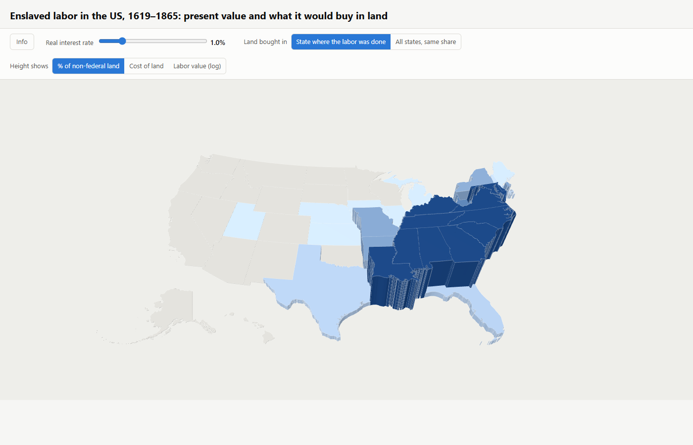

# CT69.A1.Reparations

Estimates the present value of enslaved labor in the US (1619–1865) and what it would buy in land, state by state. Includes a 3D three.js map.



- **Open the viewer:** double-click `index.html`. three.js is bundled in `lib/three/`, so no internet or server is needed. Info panels start hidden; press **Info** to show them.
- **Methodology, sources, every assumption:** [docs/METHODOLOGY.md](docs/METHODOLOGY.md)
- **QA / verification report (every check, PASS/FAIL):** [docs/QA_REPORT.md](docs/QA_REPORT.md)
- **Context for resuming work:** [CONTEXT.md](CONTEXT.md)
- **Rebuild everything:** `python3 scripts/run_all.py`. Uses the Python standard library; `pip install pypdf` enables one extra PDF check (L3). Runs under WSL/Linux and Windows.

```
index.html       the viewer (top level; all assets relative)
lib/three/       three.js r147 (MIT), bundled locally
web/data/        model_results.js, states.js (generated by 02_model.py)
data/raw/        downloaded sources (+ MANIFEST.json with SHA-256)
data/manual/     hand-copied sources + source_verification_log.csv (where each cited number was checked)
data/processed/  tidy CSVs, results.json, per-rate state tables
scripts/         00_fetch → 01_parse → 02_model → 03_qa → 04_docs; params.json holds all assumptions; capture_images.py
docs/            METHODOLOGY, QA_REPORT (each .md shadowed by .html)
images/          screenshots of the viewer
```

## Put it online with Render (free static site)
1. Push this folder to a GitHub repo (`index.html` and `render.yaml` at the repo root).
2. On render.com: **New → Blueprint**, pick the repo, then **Apply**. `render.yaml` sets it up as a static site with no build step.
3. The site goes live at `https://ct69-a1-reparations.onrender.com`, or a similar name if that one is taken. Every push to GitHub redeploys it.
